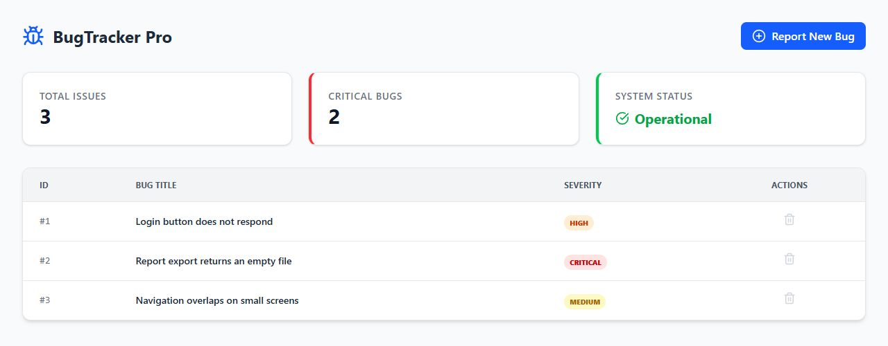

# Bug Tracker Pro

A full-stack bug tracker with a React dashboard, a FastAPI REST API, and local SQLite persistence.

[Demonstração](docs/demo.md) · [Executar](#execução-local) · [API](#api)



[English](#overview) · [Português](#visão-geral) · [Frontend guide](frontend/README.md)

## Overview

Bug Tracker Pro records software issues and presents their severity in a dashboard. The frontend and backend run as separate applications connected through HTTP requests.

### Features

- Create an issue with a title and severity. The form offers `Low`, `Medium`, `High`, or `Critical`.
- List issues by ID, title, and severity.
- Delete an issue after confirmation in the browser.
- Display the total number of issues and the count of `High` and `Critical` issues.
- Update an issue's severity through the API.

The dashboard loads records on startup and refreshes after creating or deleting an issue. It does not use streaming, polling, or WebSockets. Severity updates are available through the API; the interface does not include an edit action.

### Stack and structure

| Component | Technologies | Location |
| --- | --- | --- |
| Dashboard | React 19, Vite 7, Tailwind CSS 4, Axios, Lucide React | [frontend/](frontend/) |
| REST API | Python, FastAPI, Pydantic, SQLAlchemy | [backend/](backend/) |
| Persistence | SQLite | `backend/sql_app.db` when started from `backend/` |

SQLite tables are created when the backend starts. The database file is excluded from version control.

### Run locally

Requirements: Python compatible with [backend/requirements.txt](backend/requirements.txt), and Node.js compatible with Vite 7 (20.19+ or 22.12+), with npm.

From the repository root, start the backend in one terminal:

```powershell
cd backend
python -m venv .venv
.\.venv\Scripts\Activate.ps1
python -m pip install -r requirements.txt
python -m uvicorn main:app --reload
```

On macOS or Linux, replace the activation command with `source .venv/bin/activate`.

In a second terminal, also from the repository root:

```sh
cd frontend
npm ci
npm run dev -- --port 5173 --strictPort
```

Open the dashboard at [localhost:5173](http://localhost:5173) and the interactive API documentation at [localhost:8000/docs](http://localhost:8000/docs).

The frontend calls `http://localhost:8000/bugs`. CORS accepts `http://localhost:5173`; use that origin for the dashboard. See the [frontend guide](frontend/README.md) for available scripts.

### API

| Method | Route | Purpose |
| --- | --- | --- |
| `GET` | `/` | API status message |
| `GET` | `/bugs` | List issues |
| `POST` | `/bugs` | Create an issue |
| `PATCH` | `/bugs/{bug_id}?new_severity=High` | Update severity using a query parameter |
| `DELETE` | `/bugs/{bug_id}` | Delete an issue |
| `GET` | `/test-db` | Return the record count and stored issues |

Example `POST /bugs` body:

```json
{
  "title": "Login button does not respond",
  "description": "The form remains unchanged after clicking Sign in.",
  "severity": "High"
}
```

The API accepts severity as free text and an optional description, defaulting to `No description provided`. The dashboard submits only the title and severity. For a missing issue, update and delete return an `error` field in the response body rather than an HTTP 404.

### Deployment considerations

- The application has no authentication or authorization layer. The delete confirmation is an interface interaction, not access control.
- The **System Status** card is a fixed label, not a backend health check.
- CORS controls allowed browser origins; it does not authenticate API requests.
- [docker-compose.yml](docker-compose.yml) starts a PostgreSQL service only. The application currently uses SQLite and is not connected to that service. Docker is not needed for the local setup above.

---

## Visão geral

O Bug Tracker Pro registra problemas de software e apresenta suas severidades em um painel. Frontend e backend são aplicações separadas, conectadas por requisições HTTP.

### Funcionalidades

- Cadastrar um problema com título e severidade. O formulário oferece `Low`, `Medium`, `High` ou `Critical`.
- Listar problemas por ID, título e severidade.
- Excluir um problema após confirmação no navegador.
- Exibir o total de problemas e a contagem de itens `High` e `Critical`.
- Atualizar a severidade de um problema pela API.

O painel carrega os registros ao iniciar e atualiza a lista após cadastro ou exclusão. Não utiliza streaming, consultas periódicas ou WebSockets. A edição de severidade está disponível na API; a interface não possui ação de edição.

### Tecnologias e organização

| Componente | Tecnologias | Localização |
| --- | --- | --- |
| Painel | React 19, Vite 7, Tailwind CSS 4, Axios, Lucide React | [frontend/](frontend/) |
| API REST | Python, FastAPI, Pydantic, SQLAlchemy | [backend/](backend/) |
| Persistência | SQLite | `backend/sql_app.db` ao iniciar em `backend/` |

As tabelas SQLite são criadas na inicialização do backend. O arquivo do banco não é versionado.

### Execução local

Requisitos: Python compatível com [backend/requirements.txt](backend/requirements.txt) e Node.js compatível com Vite 7 (20.19+ ou 22.12+), com npm.

Na raiz do repositório, inicie o backend em um terminal:

```powershell
cd backend
python -m venv .venv
.\.venv\Scripts\Activate.ps1
python -m pip install -r requirements.txt
python -m uvicorn main:app --reload
```

No macOS ou Linux, substitua a ativação por `source .venv/bin/activate`.

Em outro terminal, também a partir da raiz do repositório:

```sh
cd frontend
npm ci
npm run dev -- --port 5173 --strictPort
```

Acesse o painel em [localhost:5173](http://localhost:5173) e a documentação interativa da API em [localhost:8000/docs](http://localhost:8000/docs).

O frontend utiliza `http://localhost:8000/bugs`. O CORS aceita `http://localhost:5173`; use esse endereço para abrir o painel. Os scripts disponíveis estão no [guia do frontend](frontend/README.md).

### API

As rotas estão na [tabela da API](#api). A API recebe `severity` como texto livre. O cadastro recebe `title`, `severity` e uma `description` opcional, cujo padrão é `No description provided`. O painel envia apenas título e severidade. A atualização utiliza `new_severity` como parâmetro de consulta. Quando o registro não existe, atualização e exclusão retornam um campo `error` no corpo, em vez de HTTP 404.

### Considerações de implantação

- Não há autenticação ou autorização. A confirmação de exclusão é uma interação da interface, não um controle de acesso.
- O cartão **System Status** apresenta um texto fixo, sem verificar a saúde do backend.
- O CORS controla origens permitidas no navegador; não autentica requisições à API.
- [docker-compose.yml](docker-compose.yml) inicia somente um serviço PostgreSQL. A aplicação utiliza SQLite e não está conectada a esse serviço. Docker não é necessário para a execução local descrita acima.
